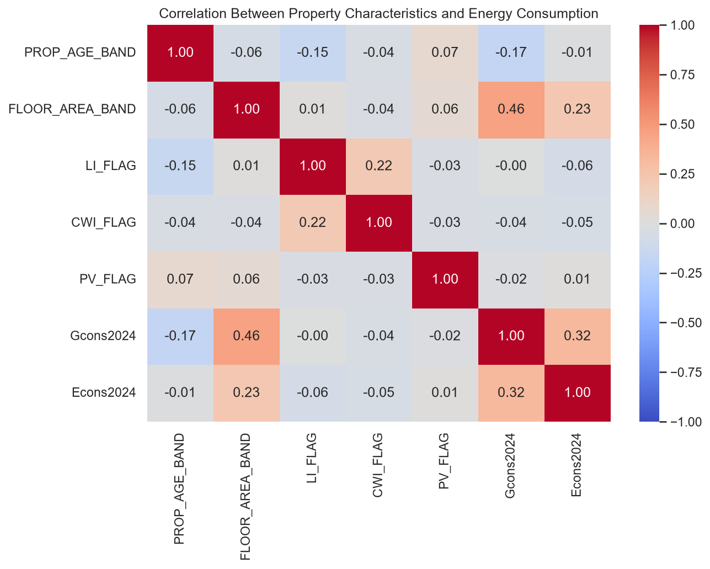
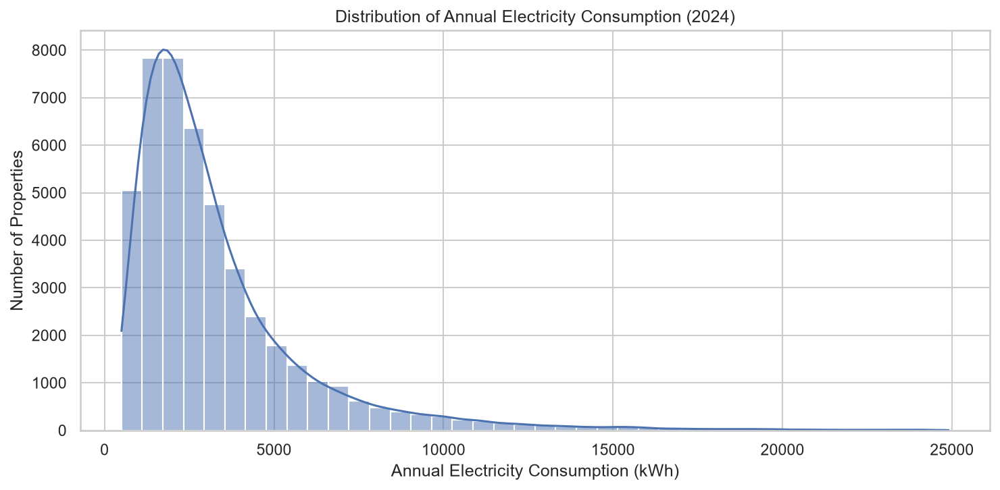
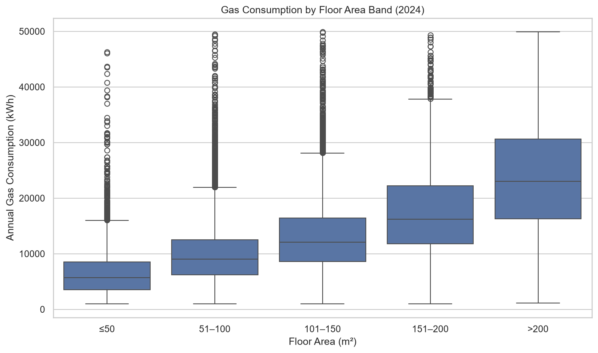
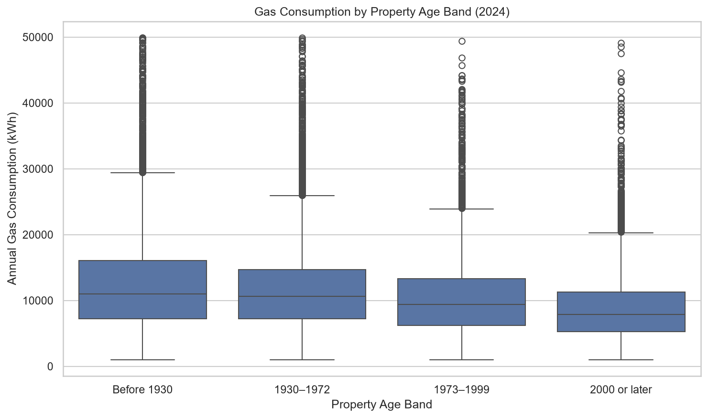
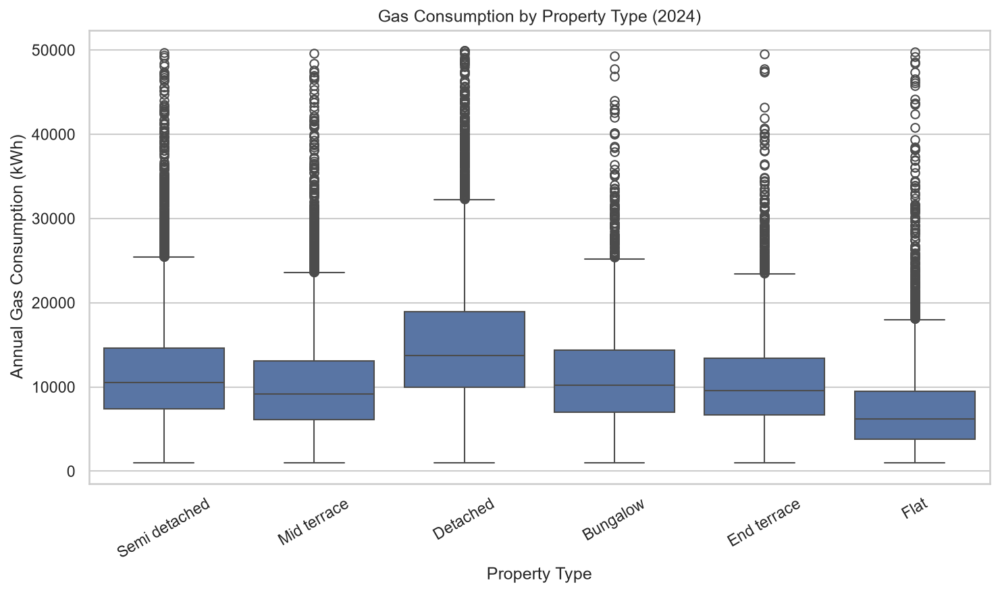
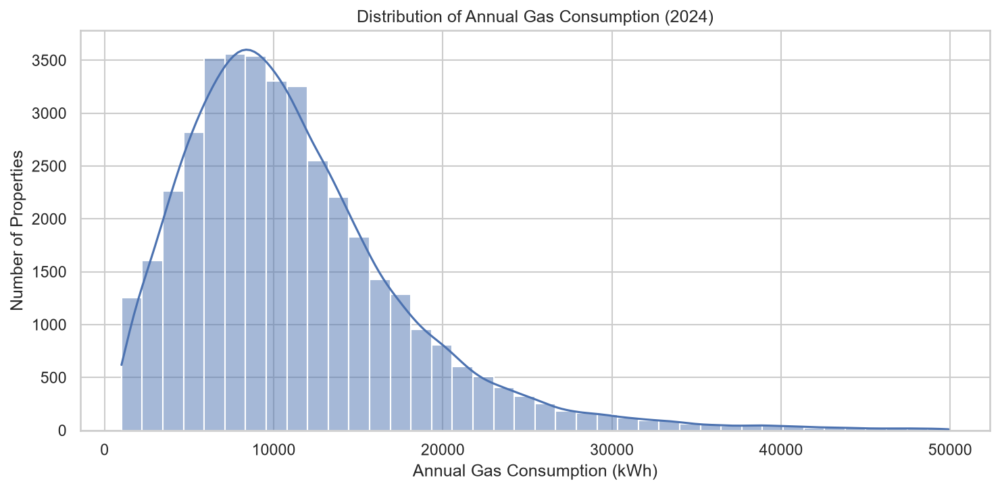
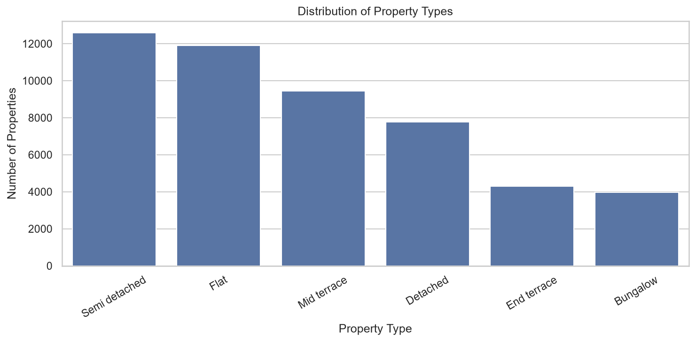

# Group 4 — Residential Gas and Electricity Consumption: Data Cleaning and EDA

## 1. Project Overview and Use Case

This project investigates residential building characteristics and annual gas and electricity consumption in a sample of domestic properties in **England and Wales**. It cleans a property-level dataset, evaluates missing data and validation flags, and explores how property type, age and floor area relate to energy demand. The notebook is an exploratory analysis, not a causal study or a trained prediction model.

## 2. Research Questions

1. How are property types and Energy Performance Certificate (EPC) categories distributed in the sample?
2. How did average annual gas and electricity consumption change between 2005 and 2024?
3. How does 2024 gas consumption differ by property type, property age and floor-area band?
4. What correlations exist among building characteristics, gas consumption and electricity consumption?
5. What data-quality limitations should be considered before modelling energy demand?

## 3. Dataset

- **Input:** `data/anon2026_50k.csv`
- **Unit of observation:** one sampled domestic property
- **Original size:** 50,000 rows × 96 columns
- **After exact duplicate removal:** 49,998 rows × 96 columns
- **Geographic scope:** England and Wales, as described in the notebook
- **Time coverage:** annual gas and electricity consumption for 2005–2024

Selected fields include:

| Field(s) | Meaning / use |
|---|---|
| `PROP_TYPE` | Residential property type |
| `PROP_AGE_BAND` | Property construction-age category |
| `FLOOR_AREA_BAND` | Floor-area category |
| `EPC` | Recorded EPC category, including `No EPC` |
| `Gcons2005`–`Gcons2024` | Annual gas consumption (kWh) |
| `Econs2005`–`Econs2024` | Annual electricity consumption (kWh) |
| `LI_FLAG`, `CWI_FLAG`, `PV_FLAG` | Loft insulation, cavity wall insulation and solar PV installation indicators |
| `LI_DATE`, `CWI_DATE`, `PV_DATE` | Corresponding installation dates, where applicable |
| `IMD_BAND_ENG`, `IMD_BAND_WALES` | Country-specific deprivation bands |
| `GasValFlag*`, `ElecValFlag*` | Consumption-data validation flags |

## 4. Repository Structure

The following structure reflects the folders and files visible in the VS Code project. The cleaned CSV is an output generated by the notebook and is not shown as an existing repository file.

```text
Group4-day1-assignment/
├── .gitignore
├── LICENSE
├── README.md
├── requirements.txt
├── uk_energy_consumption_eda.ipynb
├── data/
│   ├── .gitkeep
│   └── anon2026_50k.csv
├── figures/
│   ├── average_annual_electricity_consumption.png
│   ├── average_annual_gas_consumption.png
│   ├── average_energy_by_building_type.png
│   ├── correlation_heatmap_2024.png
│   ├── electricity_consumption_distribution_2024.png
│   ├── epc_distribution.png
│   ├── gas_consumption_by_floor_area.png
│   ├── gas_consumption_by_property_age.png
│   ├── gas_consumption_by_property_type.png
│   ├── gas_consumption_distribution_2024.png
│   ├── gas_vs_electricity_consumption_trends.png
│   └── property_type_distribution.png
└── notebook/
```

**Notes:** The `notebook/` directory is visible in VS Code, but its contents have not been verified. The local `.venv/` virtual environment is intentionally omitted because it is not normally tracked in Git. Running the notebook creates `data/anon2026_50k_cleaned.csv`; it should be added to this tree only if that output is saved and included in the repository. The structure above is based on the supplied VS Code view, not a fresh listing of the live GitHub repository.

## 5. Tools and Libraries

- Python and Jupyter Notebook (run in VS Code or another Jupyter environment)
- `pandas` and `numpy` for data processing
- `matplotlib` and `seaborn` for visualizations
- `pathlib` for file paths

The notebook also imports `zipfile` and `urllib.request.urlretrieve`, although its executed data-loading step reads a local CSV.

## 6. How to Run

1. Clone or download the repository and open its root folder in VS Code.
2. Create and activate a Python virtual environment, if needed.
3. Install dependencies from `requirements.txt` (ensure the packages used by the notebook are included).
4. Ensure the input file exists at `data/anon2026_50k.csv`.
5. Open `uk_energy_consumption_eda.ipynb`, select a Python kernel with the required packages and run the cells in order.
6. The notebook writes its cleaned dataset to `data/anon2026_50k_cleaned.csv` and saves graphs in `figures/`.

```bash
python -m pip install -r requirements.txt
```

**Important:** Run from the repository root because the notebook uses relative `data/` and `figures/` paths.

## 7. Data Quality Checks and Cleaning

The notebook copies the source DataFrame, checks duplicate records, examines missing values, validates categories and consumption ranges, and exports the cleaned result. It does **not** globally remove missing values or impute all fields.

| Quality check | Observed result | Action / justification |
|---|---|---|
| Duplicate rows | 50,000 original rows; 49,998 remaining | Removed **2 exact duplicate rows** with `drop_duplicates()`; verified 0 remain. The four rows shown by `duplicated(keep=False)` include original and repeated occurrences. |
| Missing values | **809,894 missing cells (16.87%)**; 86 of 96 columns have missing values | Retained missing data rather than indiscriminately dropping rows or imputing values. Interpretation depends on each field. |
| Data types | **46 `float64`, 44 `str`, 6 `int64`** columns in the executed environment | Inspected column types and categorical codes. No blanket conversion of all columns is documented. |
| Outliers and range checks | **0 negative values** across annual gas and electricity consumption columns; gas observed approximately 1,000–50,000 kWh, electricity approximately 500–25,000 kWh | Reviewed summary statistics and validation flags. No general outlier-removal procedure is documented; reporting thresholds limit observed ranges. |
| Feature engineering | **No new persistent columns** added to the cleaned 96-column dataset | Derived grouped statistics, indices and temporary analysis series for visualizations without changing the exported dataset schema. |

### Missingness and installation indicators

- `PV_DATE`: 49,198 missing (98.40%).
- `IMD_BAND_WALES`: 47,576 missing (95.16%); the Wales deprivation index is country-specific.
- `CWI_DATE`: 42,834 missing (85.67%).
- `LI_DATE`: 42,818 missing (85.64%).
- `CONSERVATORY_FLAG`: 40,461 missing (80.93%).

The notebook's cross-tabulations show that installation dates are present for properties with their corresponding installation flag set to 1 and absent when the flag is 0. These absences should not automatically be treated as errors.

**Cleaned output:** `data/anon2026_50k_cleaned.csv` (49,998 rows × 96 columns). The notebook re-reads this export to verify its dimensions.

## 8. Exploratory Data Analysis — Visualizations

The following figures are presented in the same order as their filenames in the `figures/` folder. They are generated by the executed notebook.

### 1. Average Annual Electricity Consumption

The annual mean electricity consumption series for 2005–2024 shows an overall decline, from approximately **4,579 kWh** in 2005 to **3,339 kWh** in 2024. Year-to-year variation remains.


### 2. Average Annual Gas Consumption

Average annual gas consumption decreases overall from approximately **18,465 kWh** in 2005 to **11,209 kWh** in 2024, with some fluctuations.


### 3. Average Energy Consumption by Building Type

This figure compares **mean electricity consumption in 2024** across property types. Despite the filename's general wording, the notebook's code specifically uses `Econs2024`.


### 4. Correlation Heatmap (2024)

The correlation heatmap compares selected building characteristics and 2024 consumption measures. Floor-area band correlates positively with gas consumption (**r = 0.46**) and electricity consumption (**r = 0.23**); gas and electricity consumption correlate at **r = 0.32**. These are associations, not proof of causation.



### 5. Electricity Consumption Distribution (2024)

The distribution of `Econs2024` is right-skewed, with most observations at lower consumption levels and fewer properties with high values.



### 6. EPC Distribution

The recorded categories are **No EPC: 30.17%**, **D: 26.03%**, **C: 24.82%**, **A/B: 10.58%**, **E: 7.13%**, and **F/G: 1.27%**. The combined A/B and F/G groups follow the notebook's categories.


### 7. Gas Consumption by Floor Area

Median gas consumption increases across floor-area bands, from approximately **5,500 kWh** for properties of 50 m² or less to **23,000 kWh** for those above 200 m².



### 8. Gas Consumption by Property Age

Median gas consumption generally declines from older to newer property-age groups: approximately **11,000 kWh** for pre-1930 properties versus **7,900 kWh** for properties built in 2000 or later.



### 9. Gas Consumption by Property Type

Detached properties have the highest 2024 median annual gas consumption (**13,700 kWh**), while flats have the lowest (**6,200 kWh**). Building size and other characteristics may contribute to the difference.



### 10. Gas Consumption Distribution (2024)

The 2024 gas-consumption distribution is right-skewed, indicating that fewer properties have relatively high recorded consumption.



### 11. Gas vs. Electricity Consumption Trends (2005–2024)

The two series are indexed to **2005 = 100**, enabling comparison of proportional change despite different absolute consumption levels. Both decline overall during the period.


### 12. Property Type Distribution

This figure summarizes the representation of six property types. The notebook identifies semi-detached properties as the most represented group.



## 9. Key Findings

1. **Gas consumption declined:** Average annual gas consumption fell from **18,465.19 kWh (2005)** to **11,208.82 kWh (2024)**, a reduction of approximately **39.3%** in the observed annual means.
2. **Electricity consumption declined:** Average annual electricity consumption fell from **4,578.83 kWh (2005)** to **3,338.70 kWh (2024)**, a reduction of approximately **27.1%**.
3. **EPC coverage is incomplete:** **30.17%** of sampled properties have `No EPC`; among the full sample, D (**26.03%**) and C (**24.82%**) are the most common recorded categories.
4. **Building form and size matter:** Detached properties have a median gas consumption of **13,700 kWh**, compared with **6,200 kWh** for flats. Median gas use increases substantially with floor-area band.
5. **Correlations are moderate or weaker:** Floor-area band and gas consumption correlate at **r = 0.46**, while gas and electricity consumption correlate at **r = 0.32**.
6. **Cleaning preserves coverage:** Only **2 exact duplicates** were removed; **49,998 records** remain, while documented missingness and validation flags were retained for appropriate interpretation.

## 10. Limitations and Biases

- **Missing information:** 809,894 cells (16.87%) are missing; analysis-specific sample sizes may vary depending on which variables are present.
- **Consumption thresholds and flags:** The notebook notes suppression of gas consumption below 1,000 kWh or above 50,000 kWh and electricity consumption below 500 kWh or above 25,000 kWh. Recorded distributions therefore exclude some extremes of actual consumption.
- **Sampling and geography:** This is a prepared sample of domestic properties in England and Wales, not a census of every property. Findings should not automatically be generalized to other regions or the full housing stock.
- **EPC and observed consumption differ:** EPC describes assessed building performance, while measured consumption also reflects occupancy, behavior and operating conditions.
- **Unobserved factors:** Occupancy, weather, heating preferences, insulation details and other characteristics may influence consumption. Associations in plots and correlations do not establish causes.
- **Historical comparison:** Different years may have different available consumption observations. Changes in sample composition, energy prices, weather and reporting practices can affect trends.
- **Outlier handling:** The notebook checks negative values and observed ranges but does not document a general statistical outlier-removal process.

## 11. Future Work — Predictive Modelling

The notebook outlines two possible regression tasks but **does not train or evaluate prediction models**:

- **Gas prediction:** target `Gcons2024`.
- **Electricity prediction:** target `Econs2024`.

Candidate predictors include property type, age and floor-area bands, EPC category, region, council-tax band, deprivation indicators and insulation/solar installation flags. Future work should include missing-data strategies, categorical encoding, validation-aware filtering, train/test splitting and model evaluation.

## 12. AI Usage Disclosure

**Tool:** ChatGPT (conversational assistance; not an autonomous agent editing the repository in this workflow).

**Why:** To understand Python and Git/GitHub workflows, troubleshoot installation and version-control issues.

**Where:** Assistance was used for learning Pandas, plotting approaches, Git branching and Pull Requests. 
